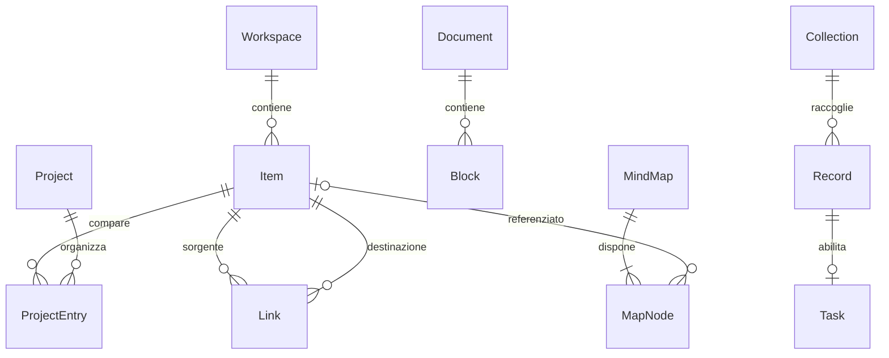

# Modello dati target — workspace a progetti

23 ottobre 2026. Specifica progettuale, non schema già implementato. Il runtime 0.1.3 usa ancora schemaVersion 1. La prima migrazione ai progetti introdurrà v2; le funzionalità successive avranno migrazioni esplicite, senza richiedere tutto questo modello nella prima release.

## Scelta e alternative

| Soluzione | Conseguenza | Decisione |
|---|---|---|
| Un progetto possiede ogni nota | Riutilizzo tramite copie divergenti | Scartata |
| Tutto è un grafo generico senza tipi | Regole, editor e navigazione diventano difficili da validare | Scartata |
| Contenuti tipizzati indipendenti, appartenenze e link | Un'identità con più contesti organizzativi | Scelta |

Il grafo è una proiezione di relazioni memorizzate. Non richiede inizialmente un graph database né una rete neurale: indici source/target e interrogazioni limitate bastano per il primo caso d'uso. Gli embedding AI futuri saranno indici derivati, ricostruibili e distinti dai link espliciti.

## Identità e proprietà comuni

ID opachi e stabili, unici nel workspace. Le entità modificabili hanno revision, createdAt, updatedAt e deletedAt nullable. Date di audit in UTC; scadenze di task come date civili, orari pianificati separati con timezone. Le revisioni sono incrementali, non timestamp usati per risolvere conflitti.

`Item` è un registro logico di identità, non una tabella unica di JSON arbitrario. Ogni Item ha esattamente un payload tipizzato coerente con kind. La realizzazione fisica può usare object store IndexedDB e indici; il dominio non dipende da IndexedDB. Link e appartenenze devono riferirsi a Item dello stesso workspace.

| Entità | Campi principali oltre agli identificatori | Regole |
|---|---|---|
| Workspace | name, schemaVersion | Confine di archivio/export; non introduce account o permessi multiutente |
| Item | workspaceId, kind, revision, deletedAt | kind: project, document, record, collection, mindmap |
| Project | itemId, title, description, status | status active/archived; archiviazione non distruttiva |
| Document | itemId, title | Nota e pagina usano lo stesso formato |
| Block | id, documentId, parentBlockId, orderKey, type, payload | Gerarchia aciclica nello stesso documento; payload versionato e validato per tipo |
| ProjectEntry | id, projectId, itemId, parentEntryId, orderKey | Unicità (projectId,itemId); parent nello stesso progetto, nessun ciclo; non associa un project come contenuto |
| Collection | itemId, title | Database di record; non è una tabella nel testo |
| Property | id, collectionId, name, type, config | Tipi iniziali text/number/date/select/checkbox; opzioni select con ID stabili |
| Record | itemId, collectionId nullable, title, documentId nullable | Al massimo una collection nel primo modello; documento esteso opzionale |
| PropertyValue | recordId, propertyId, value | Unicità coppia; tipo e collection coerenti |
| Task | recordId, status, priority, dueDate, completedAt | Capacità opzionale di Record; non copia distinta; la checkbox del documento rimane un blocco |
| SavedView | id, projectId, sourceCollectionId nullable, kind, filter, sort, groupBy | Table/board; fonte collection oppure task associati al progetto; filtro dichiarativo, mai codice eseguibile |
| Link | id, sourceItemId, targetItemId, relation, sourceBlockId nullable | sourceBlock deve appartenere al documento sorgente; endpoint validi; relazioni iniziali references/related_to/depends_on |
| MindMap | itemId, title, rootNodeId | Una radice; struttura ad albero per il primo editor |
| MapNode | id, mapId, parentNodeId, targetItemId nullable, label, x, y | Nodo testuale oppure riferimento; parent nella stessa mappa; posizione finita e limitata |
| Asset | id, workspaceId, mediaType, byteLength, sha256, formatVersion | Blob separato dai metadati; integrità verificata all'import |
| AssetReference | id, assetId, ownerType, ownerId | Proprietario blocco o tratto; consente conteggio riferimenti prima della pulizia |
| Drawing | blockId, canvasBounds, backgroundAssetId nullable | Contenuto di un blocco drawing; documento solo manoscritto = documento con drawing |
| DrawingStroke | id, drawingBlockId, orderKey, assetId | Asset di punti/pressione e stile validati; trasformazioni e undo nel modello del disegno |

Task.status è inizialmente todo/doing/done globale al task. Una board proietta questo stato: spostare un task cambia tutte le sue viste. Se serviranno workflow diversi per progetto, aggiungere esplicitamente uno stato contestuale; non sovraccaricare Task.status silenziosamente. Una stessa nota può essere referenziata da più record senza duplicarne il testo.

## Cardinalità principali

Il diagramma mostra le relazioni principali, non tutte le FK o i payload. Project, Document, Record, Collection e MindMap sono specializzazioni 1:1 di Item. SavedView non possiede copie di record. ProjectEntry è organizzazione; Link è relazione semantica; MapNode è disposizione visuale: non sono intercambiabili.

## Riutilizzo, gerarchia e navigazione

Esempio: `doc-reti` è associato a “Corso informatica” e “Infrastruttura scuola”. Le due ProjectEntry hanno ID propri ma lo stesso itemId. Rinominare o modificare il documento aggiorna entrambe. Spostare la sua entry cambia solo la gerarchia del progetto corrente. I figli non vengono associati automaticamente quando si aggiunge una singola nota a un altro progetto.

Azioni distinte nell'interfaccia:
- Aggiungi a progetto: crea un'appartenenza; nessuna copia.
- Collega: crea un Link esplicito; non cambia le appartenenze.
- Inserisci in mappa: crea un MapNode riferito al contenuto; non crea automaticamente un Link.
- Duplica: crea nuovi ID e una copia indipendente; i link verso contenuti esterni restano riferimenti dichiarati.

I progetti si collegano tra loro con Link. Una nota senza ProjectEntry resta raggiungibile in “Tutti i contenuti / Non organizzati”. La query di una board include record associati direttamente al progetto e record della collection associata, con deduplicazione per ID. I record raggiunti solo tramite link non entrano automaticamente nella board.

## Grafo e mappe mentali

Backlink = query inversa dei Link; non duplicare un secondo archivio di backlink. Per related_to normalizzare la coppia non orientata; references/depends_on sono orientati. La derivazione dei link dai blocchi richiede nodi reference con target ID, non riconoscimento basato sul titolo. Modifica del blocco e aggiornamento dei link derivati devono essere atomici; le relazioni manuali hanno sourceBlockId null.

Grafo: nodi Item, archi Link; appartenenze e riferimenti delle mappe come livelli opzionali con etichette diverse. Vista iniziale locale: progetto selezionato o vicinato a un salto. Espansione e grafo globale espliciti; budget iniziale 500 nodi/1500 archi, troncamento visibile, filtri e lista accessibile alternativa. Non inferire relazioni dalla sola vicinanza sul canvas.

Mappe: parentNodeId definisce la gerarchia; x/y definiscono il layout. Per il primo editor, niente cicli o più genitori. Uno stesso documento può comparire in mappe o nodi diversi. Un riferimento usa il titolo corrente salvo label di presentazione esplicita. Mappe e grafi si esportano con i riferimenti, non solo come immagini.

## Disegni, codice e AI

Disegno: tratti vettoriali canonici, anteprima raster derivata e rigenerabile. Asset di tratti in un formato dati versionato, senza script SVG arbitrari. Disegno e testo possono convivere in una pagina. Riconoscimento della scrittura non incluso; eventuale trascrizione è separata e non sostituisce l'originale. Prova penna/touch/palm rejection su iPad reale prima della selezione del componente.

Codice: payload `{text, language}`; text è autorevole, token di highlighting sono derivati. Linguaggio sconosciuto → testo semplice. Il rendering non esegue codice né interpreta HTML dell'utente. Primo set previsto: C, C++, C#, Python, JavaScript, TypeScript, SQL, Bash, JSON e plaintext; caricare solo le grammatiche necessarie. La libreria sarà scelta dopo audit licenza, footprint e comportamento mobile.

AI: futura porta CompletionProvider, input esplicito e risposta come proposta. Richiesta legata a documentId, blockId e revision; completamento obsoleto scartato o ripresentato per conferma, mai applicato automaticamente. Nessuna risalita implicita del grafo; l'utente seleziona contesto e provider locale/remoto. Timeout, annullamento, limite token/costi e undo richiesti. Nessuna credenziale nel documento o nell'export.

## Eliminazione, ripristino e backup

Rimuovi dal progetto elimina solo la ProjectEntry; se ha figli, una transazione li riaggancia al suo genitore. Cestina contenuto imposta tombstone e lo nasconde dalle viste attive in tutti i progetti. Link e nodi mappa mostrano il riferimento cestinato e permettono il ripristino. Cestinare un progetto non cestina i contenuti condivisi; conserva le entry per ripristinarne la struttura.

Purge definitivo differito a una futura policy di retention/sync. Non cancellare automaticamente asset finché referenziati da contenuti attivi, cestino o revisioni conservate. Import completo atomico dopo validazione di ID, FK, cicli, tipi e hash. Archivio nativo con manifest versionato, metadati e blob; export parziale deve dichiarare dipendenze esterne mancanti. Markdown/immagini sono export di interoperabilità con report delle perdite.

## Strategia di migrazione v1 → progetti

1. Validare e conservare la sorgente v1; creare backup e marcatore di migrazione in un'area nuova.
2. Creare un progetto “Importazione precedente” con ID memorizzato nel piano di migrazione. Retry riusa quel piano; nessuna duplicazione casuale.
3. Ogni Page diventa Document conservando ID e Block. Creare ProjectEntry corrispondenti; parentId v1 diventa parentEntryId. La gerarchia non rimane un parent globale del documento.
4. Ogni task v1 diventa Record con capacità Task, conservando ID, titolo, status e dueDate. Associazione allo stesso progetto e Link references al documento indicato dal vecchio pageId. La query attività-per-pagina usa questo collegamento.
5. Le bozze v1 vengono salvate come buffer recuperabile: mappare comandi di pagina a documento; non applicarle automaticamente durante la migrazione.
6. Confrontare conteggi, contenuti, gerarchie e ID; pubblicare il nuovo archivio soltanto a commit riuscito. Su abort la sorgente resta intatta. Niente fallback silenzioso a seed.
7. Dopo nuove modifiche nel target non ricaricare automaticamente la vecchia sorgente: rollback applicativo deve preservare anche export e bozze del target.

Non introdurre tutti gli store futuri in v2: il piano definisce il dominio target; ogni incremento documenterà la propria versione e migration test.
