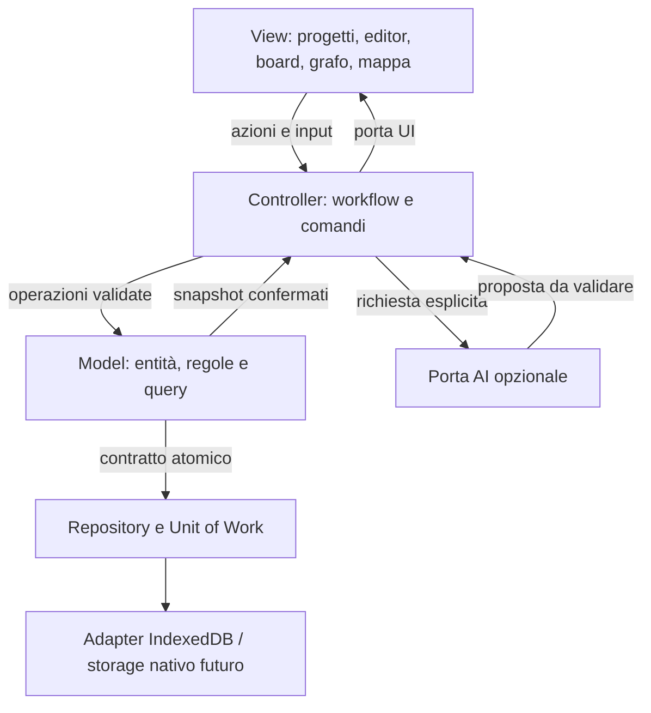

# MVC — progettazione delle funzionalità a progetti

23 ottobre 2026. Estensione progettata dell'MVC presente in 0.1.3; i componenti seguenti sono target, non codice già disponibile.

Le frecce rappresentano flussi e contratti, non import circolari: il Controller riceve la porta UI per dependency injection; il Model non importa Controller/View. La composition root collega gli adapter. Nessun provider AI deve accedere direttamente al database.

| Ambito | Model | Controller | View |
|---|---|---|---|
| Progetti | Membership, gerarchie, stato archiviazione | Crea/associa/rimuove/sposta | Dashboard e albero |
| Documenti | Blocchi, revisioni, riferimenti | Editing, bozze, undo, autosave | Editor e blocchi |
| Task/database | Record, proprietà e transizioni | Aggiornamenti e filtri | Tabella e Kanban |
| Grafo | Link e query del vicinato | Espansione, selezione, creazione link | Layout del grafo e lista alternativa |
| Mappa mentale | Nodi, riferimenti e gerarchia | Inserimento, spostamento e collegamento | Canvas navigabile e outline |
| Disegno | Tratti, asset e revisioni | Gesture normalizzate, batch, undo | Rendering penna/touch |
| Codice | Testo e linguaggio | Cambio linguaggio e modifica testo | Syntax highlighting |
| AI | Validazione proposta sul documento corrente | Contesto, annullamento e accettazione | Anteprima e scelta utente |

## Transazioni e stato

Il contratto attuale load/save di 0.1.3 resta valido per la sostituzione iniziale dello storage. Quando il modello sarà suddiviso per entità, introdurre UnitOfWork con read/write/delete logico su più store nella stessa transazione. L'adapter applica expectedRevision; il Controller non implementa SQL o chiamate IndexedDB. Progettare il contratto prima di distribuire i dati in più store.

Una mutazione confermata aggiorna revisioni, contenuti e indici autorevoli insieme. La UI mostra stato pending finché non arriva complete dal repository. Anteprime locali e tratti in corso possono essere visualizzati prima, ma non sono descritti come salvati. Errori mantengono bozza e stato confermato precedente.

Casi atomici: associazione con gerarchia, rimozione entry e riaggancio figli, modifica blocco con riferimenti, import e migrazione, aggiornamento task condiviso. Indici di ricerca, token di highlighting, layout automatico del grafo e anteprime sono derivati e ricostruibili. Il layout manuale delle mappe è dato utente e va persistito.

## Esempio completo

1. Nel progetto A, l'utente sceglie “Aggiungi a progetto B” su un documento.
2. ProjectController invia associateItem con itemId/projectId e revisione attesa.
3. Il Model verifica identità, workspace, assenza duplicati e progetto attivo.
4. Il repository scrive la ProjectEntry in transazione; il documento non viene copiato.
5. I due progetti ricevono snapshot aggiornati; una modifica successiva usa il medesimo documentId.
6. Il grafo può mostrare le due appartenenze come livello organizzativo; non inventa un Link semantico tra i progetti.

## Scelte dei componenti

Nessuna libreria definitiva in questo incremento. Editor: formato esportabile, licenza compatibile, integrazione tramite adapter, IME/undo e iOS. Grafo: rendering con budget, lavoro pesante in worker ove utile, navigazione da tastiera. Mappa/disegno: formato aperto, riferimenti esterni ai nodi, export vettoriale e affidabilità penna. Syntax highlighter: grammatiche lazy, testo ostile inerte, nessuna dipendenza da servizi remoti.

Evitare un unico canvas per editor, grafo e mappe: condividono dati e selezione, ma hanno interazioni e formati diversi. Il riuso va concentrato su ID, riferimenti, command handling, storage e asset.

## Verifica e sicurezza

Model: invarianti su ID, appartenenze, FK, gerarchie, task condivisi. Controller: autosave, retry, import, richiesta AI obsoleta e cancellazione. Adapter: transazioni reali, crash/abort, quota e migrazione. Browser: tastiera, IME, penna, touch, focus, offline e accessibilità.

Validare tutti gli import e limitare dimensione totale, numero di nodi/tratti e coordinate prima di allocare rendering. Mai eval o HTML utente non sanitizzato. Log solo codici/ID necessari, senza testi, tratti o token. Nessun upload implicito di note collegate. L'appartenenza a un progetto è organizzazione, non un permesso di sicurezza: la condivisione multiutente richiederà un modello autorizzativo separato.
